# 🔬 Awesome AI Test Failure Root Cause Analysis (RCA) 🚀

**A Curated Index of SaaS Platforms, Open-Source Tools, ML Libraries, and AI Agents for Test Failure Triage, Automated Root Cause Analysis (RCA), Flaky Test Detection, and Test Impact Analysis (TIA)** 🌟

*Stop endlessly scrolling logs. Accelerate software delivery with intelligent failure classification, predictive test impact, and agentic error remediation.* ⚡

---

## 📑 Table of Contents

- [🌐 Sector Overview & Market Dynamics](#-sector-overview--market-dynamics)
- [🏢 SaaS & Hosted Platforms](#-saas--hosted-platforms)
- [🔓 Open-Source GitHub Projects](#-open-source-github-projects)
- [💡 Architectural Comparison & Frameworks](#-architectural-comparison--frameworks)
- [🤝 How to Contribute](#-how-to-contribute)
- [💖 Support & Sponsorship](#-support--sponsorship)
- [📈 Star History](#-star-history)
- [⚠️ Disclaimer](#️-disclaimer)

---

## 🌐 Sector Overview & Market Dynamics

The global software testing and test automation market is estimated at **$50B–$60B in 2025–2026** (with the broader AI-driven automation ecosystem expanding past **$160B+** at >30% CAGR). Within this space, specialized AI test failure triage and automated root cause analysis (RCA) represent the fastest-accelerating operational frontier. 

The sector is **moderately to highly fragmented** rather than winner-take-all:
- **Observability Giants** (such as Datadog) bridge CI test spans with production APM/RUM traces.
- **Cross-Browser & Device Cloud Ecosystems** (such as BrowserStack and Sauce Labs) embed proprietary agentic failure triaging across browser automation runs.
- **Developer Observability Leaders** (such as Sentry) diagnose runtime errors and suggest code pull requests.
- **Specialized Test Intelligence Startups & Open-Source Projects** (such as Testkube, Launchable, ReportPortal, and PyRCA) drive autonomous failure classification, flaky test quarantine, and Kubernetes-native test orchestration.

---

## 🏢 SaaS & Hosted Platforms

A comprehensive side-by-side comparison of commercial platforms offering AI test failure analysis, flaky test insights, and predictive test selection, sorted by **Company Valuation / Market Scale (descending)**:

| 🏷️ Platform | 💰 Company Valuation / Scale | 💳 Starting Pricing Tier | 🎁 Free Tier / Trial Limits | 🧠 Key RCA & Test Intelligence Capabilities |
| :--- | :--- | :--- | :--- | :--- |
| **[Datadog Test Optimization](https://www.datadoghq.com/)** | **~$48B Market Cap** ($3.43B FY2025 revenue; NASDAQ: DDOG) | **$20/active committer/month** (annual billing; $24/mo monthly, $29/mo on-demand; includes 1M test spans/committer, $3/additional 1M spans; CI Pipeline Visibility add-on at $8/committer/mo) | **14-day free trial** with full platform access (bounded by evaluation span limits and 1-day retention; no permanent free tier for Test Optimization) | Early flake detection before merge, automated test retries, test impact analysis (TIA), and proprietary correlation connecting test failures directly with APM/RUM production traces. |
| **[BrowserStack Test Failure Analysis Agent](https://www.browserstack.com/)** | **~$4.0B Valuation** (~$225M–$230M ARR; profitable private unicorn) | **$59/month** (entry Automate plan with 1 parallel test; bundled with BrowserStack AI features / Test Observability) | **Free trial with 100 minutes** of automated mobile app testing and **60 minutes** of automated browser testing (no permanent free tier for AI Agent) | One-click autonomous root cause analysis agent; parses logs, execution history, and stack traces to categorize failures into product, environment, or test script bugs with fix suggestions. |
| **[Sentry Seer](https://sentry.io/)** | **~$3.0B Valuation** (~$100M–$120M ARR; Functional Software Inc.) | **$26/month** (Team Plan base; Seer AI features billed at **$20/month** add-on including $25/month AI usage credits) | **Free forever plan ("Developer Plan")**: 1 user, 5,000 error events/mo, 10,000 performance units, 50 session replays/mo, 30-day retention; plus 14-day paid trial | AI root cause analysis across stack traces, commits, and spans with 94.5% diagnostic accuracy; suggests code remediations and can open pull requests autonomously. |
| **[Sauce Labs Failure Analytics](https://saucelabs.com/)** | **~$500M Valuation** (~$92M revenue; backed by TPG & Riverwood Capital) | **$39/month** (Live Testing entry tier; automated testing plans start at **$149/month** per concurrent session) | **28-day free trial**: 60 automated/live testing minutes, up to 3 parallel virtual machines, and sample AI insight queries (free tier available for approved open-source projects) | Enterprise failure pattern analytics across historical test suites, systemic flaky test detection, machine learning failure categorization, and Backtrace error monitoring. |
| **[Catchpoint / Thundra Foresight](https://www.catchpoint.com/)** | **~$250M Acquisition Valuation** (Catchpoint acquired Thundra assets; Catchpoint subsequently acquired by LogicMonitor for >$250M; ~$30M–$58M ARR) | **$10,000/year** (Catchpoint Quick Start synthetic/observability tier using token/factor consumption; WebPageTest developer tier from **$75/month**) | **14-day sales-provisioned free trial** (custom-scoped test credits/nodes; WebPageTest public tier offers ~150 free monthly test runs) | Distributed CI/CD tracing, erroneous test execution diagnosis, and performance bottleneck identification across automated pipelines. |
| **[Develocity Predictive Test Selection](https://develocity.ai/)** | **~$160M Valuation** (~$46M ARR; Gradle Inc.) | **$700/developer/year** (commercial starting baseline tier; quote-only annual committer license for enterprise deployment) | **Free forever on public service** (`scans.gradle.com` provides unlimited individual public Build Scans); 30-day enterprise evaluation trial upon request; free enterprise instances for open-source foundations | Machine learning model trained on code change history and test execution outcomes to select only affected tests; Build Scan failure diagnostics and build caching. |
| **[SeaLights](https://www.sealights.io/)** | **~$150M Acquisition Valuation** (Acquired by Tricentis for $150M in July 2024; raised $50M prior) | **Custom Quote** (Enterprise tier calibrated by active committers and lines of code; typically scales from ~$10,000+/year) | **Sales-provisioned enterprise POC / trial** (typically 14–30 days scoped to designated test suites; no public free tier) | Test Impact Analysis (TIA) analyzing PR pull-request code diffs to isolate and execute only impacted tests; quality governance and release risk scoring. |
| **[Launchable](https://www.launchableinc.com/)** | **~$50M–$100M Valuation Range** (Acquired by CloudBees in August 2024; raised $12.7M prior; founded by Kohsuke Kawaguchi) | **$12,000/year** (Mars for Teams tier starting pricing; enterprise usage-based predictive test selection) | **Free forever plan ("Moon for Developers")**: 1 user limit, includes flaky test notifications and test suite health insights; enterprise POC available | ML predictive test selection ordering tests by probability of failure to shorten feedback loops; flaky test scoring and suite entropy tracking. |
| **[Testkube AI](https://testkube.io/)** | **~$35M–$45M Valuation** ($8M Series A in 2025 led by Insight Partners; Kubeshop spin-off) | **$700/agent/year** (Testkube Pro cloud control-plane; AI features currently in preview at no additional charge) | **Free forever plan (OSS Standalone Edition)**: unlimited runs on self-hosted Kubernetes; **30-day free trial** for cloud-hosted Pro control plane | Native Kubernetes test orchestration with one-click AI failure diagnosis; plain-language summaries, root cause correlation with Git commits, and remediation PR creation via MCP agents. |

---

## 🔓 Open-Source GitHub Projects

Self-hosted platforms, ML libraries, diagnostic CLI utilities, and MCP servers for automated test failure root cause analysis, sorted by **GitHub_Stars (descending)**:

### 1. [ReportPortal](https://github.com/reportportal/reportportal) 
- **Description**: 📊 **AI-Powered Test Automation Dashboard & Analytics Platform** (Apache-2.0). The most mature open-source test analytics platform available, featuring an ML-based Auto-Analyzer for failure classification and automatic defect triage.
- **Key Capabilities**: 
  - **Auto-Analysis**: Categorizes failures with machine learning and links defects automatically to tracking systems.
  - **Immediate Auto-Analysis**: Initiates analysis before test launches complete to flag failures earlier in the pipeline.
  - **Pattern Analysis & Unique Error Analysis**: Define regex rules to detect known error signatures and deduplicate identical errors.
  - **Per-Project Retrained Models**: Retrains project models using XGBoost with ~30 features including cosine similarity and Random Forest probabilities.
- **Tech Stack & Deployment**: Java, Docker, Kubernetes; self-hosted or cloud.

### 2. [Testkube](https://github.com/kubeshop/testkube) 
- **Description**: ☸️ **Kubernetes-Native Test Orchestration with One-Click AI Analysis** (MIT / Community License). Enables automated test execution, failure diagnosis, and remediation directly inside Kubernetes clusters.
- **Key Capabilities**:
  - **One-Click AI Analysis**: Automatically produces comprehensive reports outlining pass/fail trends, resource consumption anomalies, execution outliers, and optimization recommendations.
  - **No Prompt Engineering Needed**: Out-of-the-box baseline reporting provides immediate failure summaries.
  - **AI Agentic Remediation**: Correlates failures with Git commits and prepares remediation pull requests with fine-grained permission guardrails.
- **Tech Stack & Deployment**: Go, Kubernetes CRDs, Helm, Docker.

### 3. [agent-qa](https://vostride.com) 
- **Description**: **Local AI QA failure analysis** (FSL-1.1-ALv2). Runs natural-language web, Android and iOS tests and produces post-run cause digests for its own recorded runs.
- **Key Capabilities**:
  - **Evidence review**: Group failures by assigned cause, then inspect steps, screenshots, console and network evidence through the CLI, dashboard or MCP.
  - **Learning from feedback**: Persistent memidex memory, validated self-improvement and reviewable verdict corrections for later test runs.
- **Tech Stack & Deployment**: TypeScript, Node.js 24+; local software requiring a configured model and test environment. $0 for permitted local use; model/compute/device and optional remote-service costs are separate.

### 4. [PyRCA (Salesforce)](https://github.com/salesforce/PyRCA) 
- **Description**: 🧠 **Python Machine Learning Library for Root Cause Analysis** (BSD-3-Clause). A comprehensive ML framework for automated root cause localization and anomaly diagnosis across complex multi-service architectures.
- **Key Capabilities**:
  - **Causal Discovery & Graph Modeling**: Supports algorithms including PC, GES, and LiNGAM to model causal relationships between components and test services.
  - **Topology & Metric-based RCA**: Provides Random Walk, Bayesian Inference, ε-Diagnosis, and hypothesis testing methods to trace anomalies to root culprits.
  - **Modular Architecture**: Clean APIs for integrating custom test metrics, trace logs, and anomaly detection models.
- **Tech Stack & Deployment**: Python, NumPy, Pandas, Scikit-learn.

### 5. [Flaky (Box)](https://github.com/box/flaky) 
- **Description**: 🔄 **Automatic Flaky Test Retry & Quarantine Plugin for Pytest & Nose** (Apache-2.0). Automatically isolates non-deterministic test failures from actual code regressions in Python CI pipelines.
- **Key Capabilities**:
  - **Configurable Rerun Thresholds**: Automatically reruns failed tests up to *N* times to determine if failures are transient or deterministic.
  - **Failure Reporting**: Generates granular post-run summaries classifying tests that passed on rerun, pinpointing flakiness before code is merged.
- **Tech Stack & Deployment**: Python, Pytest, Nose.

### 6. [GitHub Test Reporter (CTRF)](https://github.com/ctrf-io/github-test-reporter) 
- **Description**: 📋 **Universal Test Failure & Flaky Test Reporter for GitHub Actions** (MIT). Ingests Standardized Common Test Report Format (CTRF) to publish rich, interactive test failure diagnostics and flaky analysis directly into GitHub PR comments and workflow summaries.
- **Key Capabilities**:
  - **Failed Test Root Analysis**: Highlights exact stack traces, failure reasons, and duration regressions in pull requests.
  - **Flaky Test Detection**: Identifies and tracks non-deterministic test suites across recent GitHub Actions workflow runs.
  - **Framework Agnostic**: Works seamlessly with Jest, Playwright, Cypress, Pytest, JUnit, Mocha, and Go test runners.
- **Tech Stack & Deployment**: TypeScript, GitHub Actions Action.

### 7. [RCAEval](https://github.com/phamquiluan/RCAEval) 
- **Description**: 🔬 **Open-Source Benchmark & Evaluation Platform for Root Cause Analysis** (MIT). Academic and industrial evaluation framework designed to benchmark metric-, trace-, and log-based RCA algorithms.
- **Key Capabilities**:
  - **Reproducible Failure Datasets**: Includes real-world failure injection cases across distributed microservices and continuous test pipelines.
  - **Multi-Source Diagnostic Baselines**: Implements and benchmarks graph-based, metric-based, and LLM-assisted root cause localization algorithms.
- **Tech Stack & Deployment**: Python, Jupyter Notebooks.

### 8. [Captain (RWX Research)](https://github.com/rwx-research/captain) 
- **Description**: 🛡️ **CLI for Flaky Test Quarantine, Automatic Retries & Failure Summaries** (Apache-2.0). Fast, language-agnostic CLI tool for CI test intelligence that quarantines flaky tests without breaking pipeline builds.
- **Key Capabilities**:
  - **Flaky Test Quarantining**: Prevents flaky tests from blocking pull requests while keeping tests executing for data collection.
  - **Markdown Failure Summaries**: Generates concise, actionable failure breakdowns directly in CI logs.
  - **Parallel Test Partitioning**: Optimizes CI runtime through intelligent test file balancing.
- **Tech Stack & Deployment**: Go, CLI, Cross-platform binary.

### 9. [TeamCity QA Intelligence](https://github.com/kate-horshchar/teamcity-qa-mcp) 
- **Description**: 🤖 **Read-Only MCP Server for AI-Assisted CI Failure Diagnosis** (MIT). Bridges TeamCity CI/CD telemetry with AI assistants (Claude Code, Cursor, Claude Desktop) via the Model Context Protocol (MCP).
- **Key Capabilities**:
  - **19 Diagnostic MCP Tools**: Collects build failures, test run history, and log excerpts via TeamCity REST APIs.
  - **Tri-Category Classification**: Automatically attributes failure root cause to **code changes** (linked to commit author), **test instability / flakiness**, or **infrastructure breakdown**.
  - **Automated Fix Recommendations**: Provides contextual remediation prompts without manual log copy-pasting.
- **Tech Stack & Deployment**: Python, MCP SDK, TeamCity REST API.

---

## 💡 Architectural Comparison & Frameworks

| Paradigm | Exemplary Tools | Primary Objective | Trade-offs & Considerations |
| :--- | :--- | :--- | :--- |
| **One-Click Autonomous RCA Agent** | **BrowserStack Agent**, **Sentry Seer** | Pinpoint exact bug origin and suggest actionable code fixes automatically. | Requires deep context access (test history, source code, traces); often vendor-locked or proprietary. |
| **Observability-Linked RCA** | **Datadog Test Optimization** | Correlate CI test runs with live backend traces and APM telemetry. | Unrivaled full-stack visibility; pricing scales with committer seats. |
| **ML Test Failure Dashboard** | **ReportPortal**, **Sauce Labs** | Automatically cluster failure logs and auto-analyze failure types. | Requires centralized test log ingestion; primarily reporting-first rather than autonomous remediation. |
| **Predictive Test Selection (PTS)** | **Develocity**, **Launchable**, **SeaLights** | Optimize *which* tests to run based on code diffs to save CI hours. | Prevents pipeline delays; tells you *what* to run, not *why* an unexpected failure occurred. |
| **Agentic / MCP Diagnosis** | **TeamCity QA Intelligence**, **Testkube AI** | Empower conversational AI agents to interrogate CI logs and open remediation PRs. | Requires MCP setup or Kubernetes deployment; emerging ecosystem with evolving tooling. |

---

## 🤝 How to Contribute

Contributions are warmly welcomed! Help keep this guide up-to-date with emerging tools, research papers, and frameworks:

1. 🍴 **Fork the repository** on GitHub.
2. 🌿 **Create a feature branch**: `git checkout -b feature/add-new-tool`
3. 📝 **Add or update an entry** in `README.md` following the tabular format for SaaS products or the badged list format for open-source tools.
4. 🔗 **Ensure accurate links**, verified licenses, and up-to-date Stars_Counts.
5. 🚀 **Submit a Pull Request** with a concise summary of the addition!

---

## 💖 Support & Sponsorship

If you find this curated list valuable for your QA workflows, CI pipeline optimization, or root cause analysis research, please consider supporting the project:

- ⭐ **Star this repository** to help others discover it!
- 🍴 **Fork and share** with your QA, DevOps, and Platform Engineering teams.
- ☕ **Sponsor or buy a coffee**: Support ongoing curation and maintenance via the [GitHub Sponsors Dashboard](https://github.com/sponsors/ishandutta2007).

*Thank you for being part of the open test intelligence community!* 🙌

---

## 📈 Star History

---

## ⚠️ Disclaimer

- This repository is a **community-curated index** for informational and educational purposes; inclusion does not constitute a commercial endorsement.
- Automated RCA and test intelligence tools handle logs, stack traces, and internal source code diffs. Always ensure that telemetry pipelines, CI/CD integrations, and MCP servers comply with your enterprise security policies and data privacy regulations (GDPR, SOC 2, HIPAA, CCPA).
- Pricing figures, trial durations, valuations, and Stars_Counts reflect verified data as of **November 2026** and may evolve over time.

---

**Built with ❤️ for QA Engineers, Test Automation Architects, and Software Platform Teams.**

